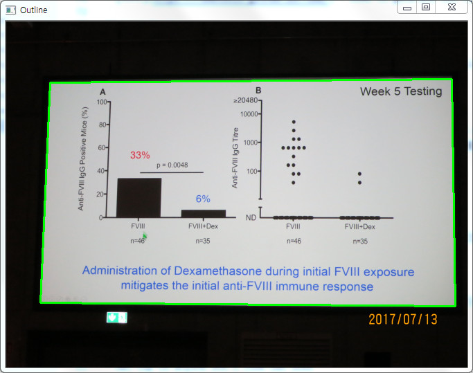
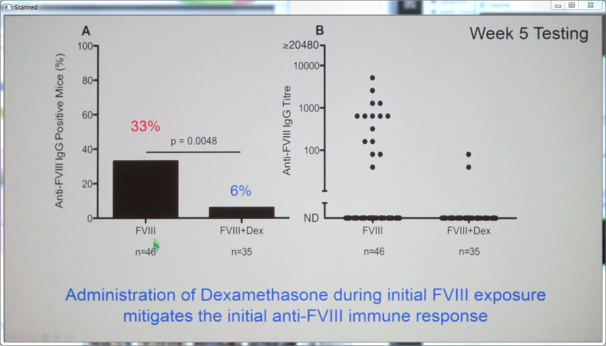

# Image Straightener

학회사진을 비스듬하게 찍어서 보기가 힘들어서 편집하는 것을 만들었습니다.

> A Python-based tool for automatically detecting and correcting skew in batches of images.

# How to Use

1. `uv`를 설치한 후, 아래 명령어로 실행합니다.

```bash
uv sync
uv build
uv run image-straightener -i data/input/ -o data/output/
```

2. 다음과 같은 창이 뜨면 녹색선을 잘 확인해보세요. `space`를 누르면 녹색선 안에 있는 이미지를 처리합니다. `esc`를 누르면 원본이미지를 저장합니다.



3. 결과 확인



## License

This project is licensed under the MIT License.
